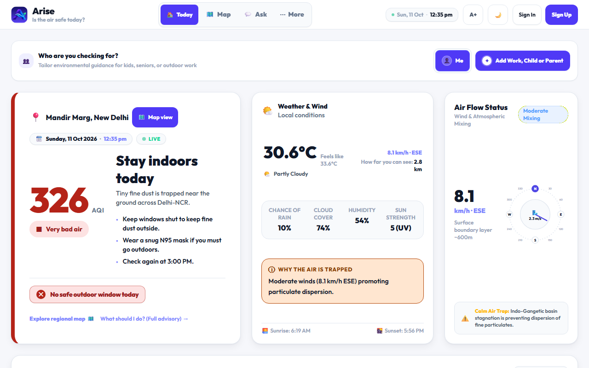
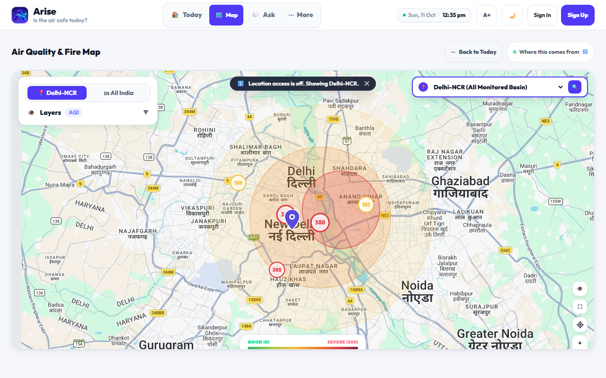
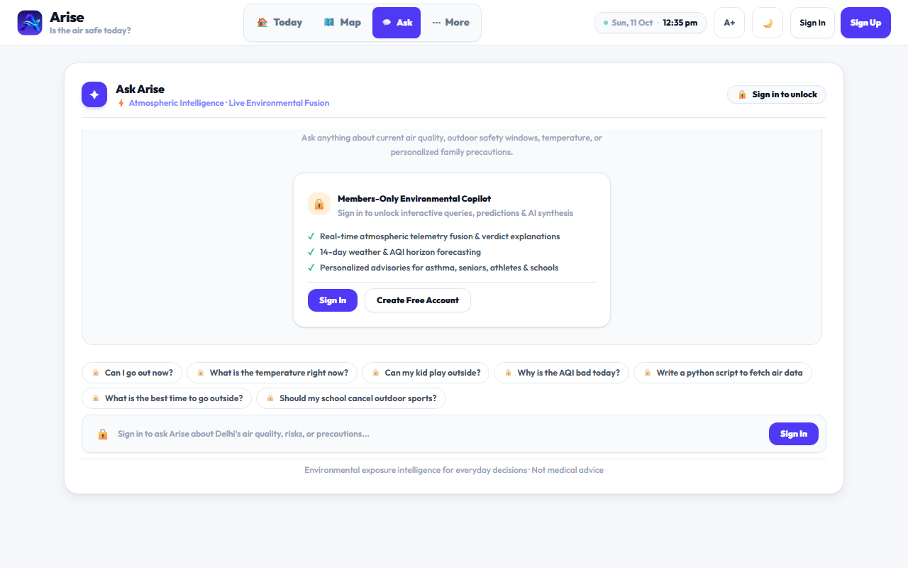
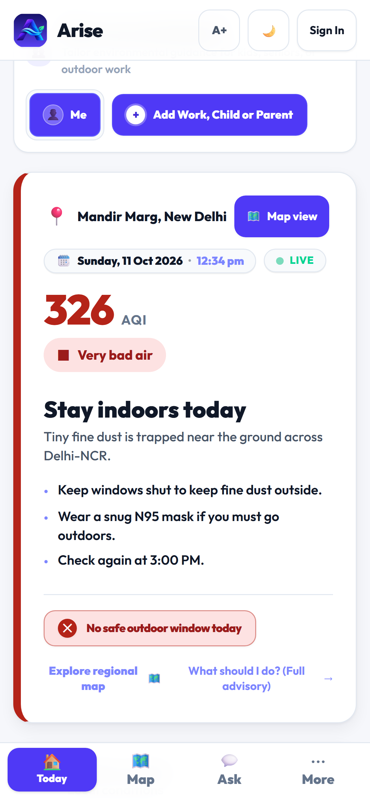
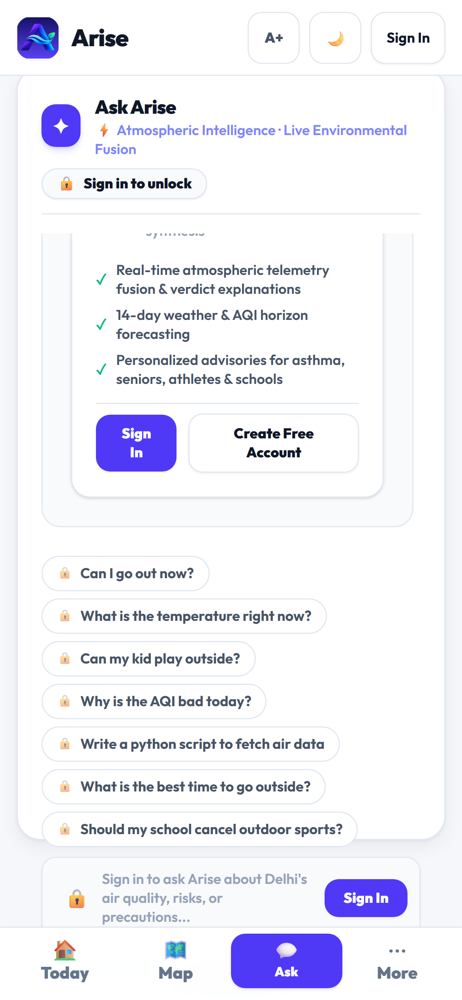
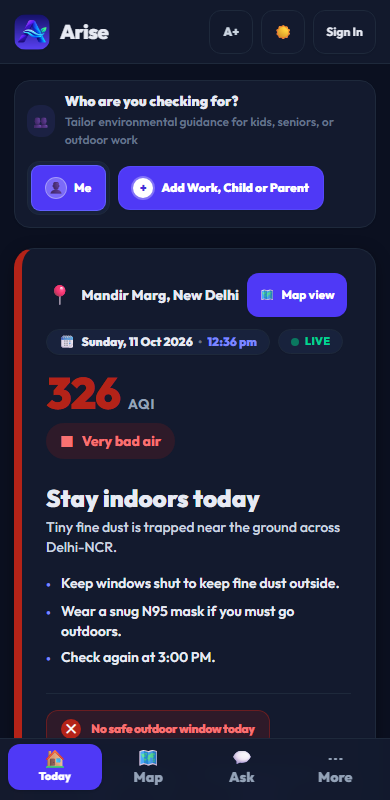

# Arise — Delhi-NCR Atmospheric & Environmental Intelligence Platform

> **AWS x WeMakeDevs "Environmental Hacks" — Air Track Submission**  
> **One-Line Pitch:** Not "what is the AQI", but *"should I go out, what should my kid/school do, and why"* — delivered in plain language with scientific precision.

[](LICENSE)
[](https://fastapi.tiangolo.com)
[](https://react.dev)
[](https://aws.amazon.com)
[](https://ai.google.dev)

---

## Live Deployments

- **Live Production Application:** [https://frontend.dqmsa8e2klyso.amplifyapp.com/](https://frontend.dqmsa8e2klyso.amplifyapp.com/)
- **Live Backend REST API:** [https://ll84ry8heh.execute-api.us-east-1.amazonaws.com/prod](https://ll84ry8heh.execute-api.us-east-1.amazonaws.com/prod)
- **API Health Check Endpoint:** [https://ll84ry8heh.execute-api.us-east-1.amazonaws.com/prod/health](https://ll84ry8heh.execute-api.us-east-1.amazonaws.com/prod/health)

---

## Detailed Documentation

- **Current Project Memory & Handoff:** [PROJECT_STATE.md](PROJECT_STATE.md) (active milestone, verified tests, blockers, pending tasks)
- **Repository Operating Rules:** [AGENTS.md](AGENTS.md) (permanent agent instructions, recovery workflow, update protocol)
- **Domain Memory & Invariants:** [SKILL.md](SKILL.md) (deterministic NAQI math, recovery modes, data hierarchy)
- **Tooling & Test Guide:** [TOOLS.md](TOOLS.md) (verified commands, environment specifications, local dev workflows)
- **System Architecture & Data Flows:** [docs/ARCHITECTURE.md](docs/ARCHITECTURE.md) (with Mermaid diagrams)
- **Product & Design Specification:** [docs/DESIGN.md](docs/DESIGN.md) (personas, bands, screens, and design tokens)
- **End-to-End Project Execution Report:** [docs/PROJECT_REPORT.md](docs/PROJECT_REPORT.md) (sanitized milestone history)

---

## Screenshots

### Desktop Experience
| Today Dashboard | Interactive Air Map |
| :---: | :---: |
|  |  |

| Ask Arise AI Copilot |
| :---: |
|  |

### Mobile & Responsive Experience
| Mobile Today (Light) | Mobile Ask Copilot | Dark Mode Mobile |
| :---: | :---: | :---: |
|  |  |  |

---

## Core Capabilities

1. **Hyper-Local Atmospheric Synthesis:**
   - Multi-station spatial interpolation using Inverse Distance Weighting (IDW, power = 2) across live CPCB and OpenAQ ground stations.
   - Computes individual sub-indices for PM2.5, PM10, NO2, SO2, CO, and O3 following official Central Pollution Control Board (CPCB) NAQI formulations.

2. **Persona-Tailored Decision Verdicts:**
   - Evaluates real-time exposure risk across 5 distinct personas: *General Public*, *Sensitive / Asthma*, *Elderly*, *Athletes / Runners*, and *Schools / Children*.
   - Outputs decisive status verdicts (`GO`, `BE SMART`, `CUT BACK`, `STAY IN`) with specific outdoor precautions and diurnal safe windows.

3. **Grounded AI Copilot ("Ask Arise"):**
   - Grounded conversational assistant powered by Google Gemini with strict pre-flight domain guardrails.
   - Enforces structured JSON responses (`verdict`, `headline`, `why`, `do`, `best_window`, `sources`).
   - Includes a deterministic rule-based safety fallback engine for sub-second, zero-downtime reliability.

4. **Satellite & Atmospheric Telemetry:**
   - Ingests NASA FIRMS (VIIRS/MODIS) satellite thermal anomalies to detect active agricultural stubble burning in the upwind Punjab/Haryana airshed.
   - Pulls hourly Open-Meteo weather forecasts, boundary layer mixing heights, and astronomical sunrise/sunset.

5. **Universal Responsive Design:**
   - Audited across 13 viewports (320px–2560px) with 0px horizontal overflow.
   - Dual map engine: Google Maps JavaScript API with an automatic, offline-capable SVG vector map fallback (`DelhiNcrVectorMap`).

---

## Quickstart & Local Setup

### Prerequisites
- **Python:** 3.12+
- **Node.js:** 20+ (Node 24 recommended)
- **Git**

---

### Backend Setup

1. **Activate the Python virtual environment (configured at repository root):**
   ```bash
   cd ~/arise
   source .venv/bin/activate
   # Or create if starting from a fresh clone:
   # python3 -m venv .venv && source .venv/bin/activate && pip install -r backend/requirements.txt
   ```

2. **Configure environment variables:**
   ```bash
   cp .env.example backend/.env
   ```
   *(Optional for local development: set `OPENAQ_API_KEY` or leave empty to use built-in fallback stations).*

3. **Start the local FastAPI development server:**
   ```bash
   cd backend
   uvicorn main:app --reload --port 8000
   ```
   The API will be available at `http://localhost:8000` (docs at `http://localhost:8000/docs`).

4. **Run backend automated tests:**
   ```bash
   # From ~/arise root:
   pytest backend/tests/

   # Or from within backend/:
   cd backend && pytest tests/
   ```

---

### Frontend Setup

1. **Ensure Node 24 is active (NVM) and install dependencies:**
   ```bash
   source ~/.nvm/nvm.sh && nvm use 24
   cd ~/arise/frontend
   npm install
   ```

2. **Configure environment variables:**
   ```bash
   cp .env.example .env.local
   ```
   *(Default points to local API `http://localhost:8000` or production API).*

3. **Start the Vite development server:**
   ```bash
   npm run dev
   ```
   The frontend will be running at `http://localhost:5173/`.

4. **Run frontend tests and production build:**
   ```bash
   npm test
   npm run build
   ```

---

## AWS Serverless Architecture

Arise is deployed to production using AWS Serverless Application Model (SAM):
- **AWS Amplify Hosting:** Global CDN delivering the React 19 single-page application.
- **Amazon API Gateway (HTTP API v2):** Low-latency entry point with strict CORS policies.
- **AWS Lambda (`ApiFunction`):** Python 3.12 running FastAPI through the Mangum ASGI adapter.
- **AWS Lambda (`IngestionFunction`):** Scheduled hourly ingestion of OpenAQ stations and NASA FIRMS fire signals.
- **Amazon EventBridge Scheduler:** Automates hourly ingestion.
- **Amazon DynamoDB:** `arise-cache-prod` (with TTL auto-expiration) and `arise-users-prod` (with Server-Side Encryption).
- **Amazon Cognito:** User authentication and profile management via PKCE OAuth 2.0 flow.
- **AWS Secrets Manager:** Secure storage for Google Gemini API credentials.

---

## Authors & Contributors

- **Yashansh Rastogi (@yashanshrastogi)**
- **Satyam Kumar (@SatyamSinghRajput04)** — frontend / UI and testing

---

## License

This project is licensed under the MIT License — see the [LICENSE](LICENSE) file for details.
