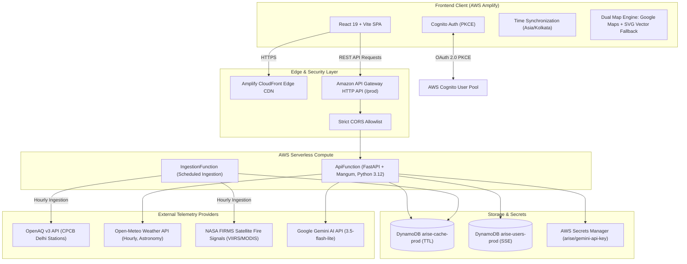
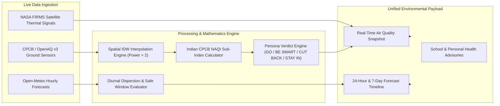
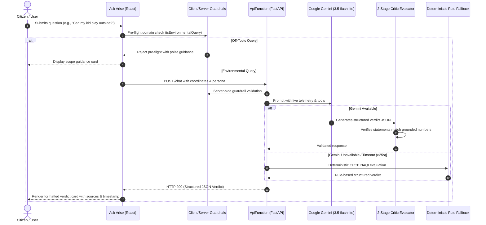

# Arise — System Architecture & Data Flow

**Delhi-NCR Atmospheric & Environmental Intelligence Platform**

---

## 1. High-Level System Architecture

Arise is a cloud-native, serverless environmental intelligence platform built on AWS and React 19.

---

## 2. Telemetry Ingestion & Synthesis Pipeline

---

## 3. Ask Arise AI Copilot Architecture

---

## 4. Security & Isolation Matrix

| Layer | Implementation | Security Control |
| :--- | :--- | :--- |
| **Edge & CDN** | AWS Amplify Hosting | Strict Content-Security-Policy headers, TLS 1.3, DDoS protection |
| **API Gateway** | HTTP API v2 | Explicit origin allowlist (no wildcard `*`), proxy route throttling |
| **Compute** | AWS Lambda (Python 3.12) | Principle of least privilege IAM execution roles; ephemeral execution |
| **Secrets** | AWS Secrets Manager | API keys stored encrypted with KMS; zero hardcoded credentials |
| **User Data** | Amazon DynamoDB | Server-Side Encryption (SSE); strict per-user partition key isolation |
| **Identity** | Amazon Cognito | OAuth 2.0 PKCE authentication flow; JWT validation on protected routes |
