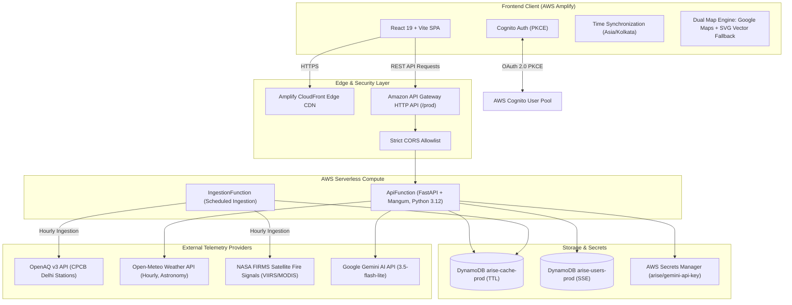
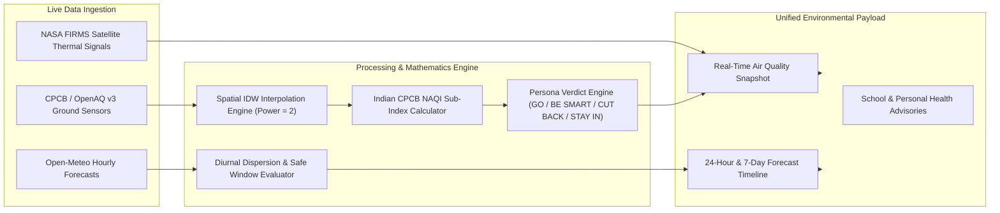
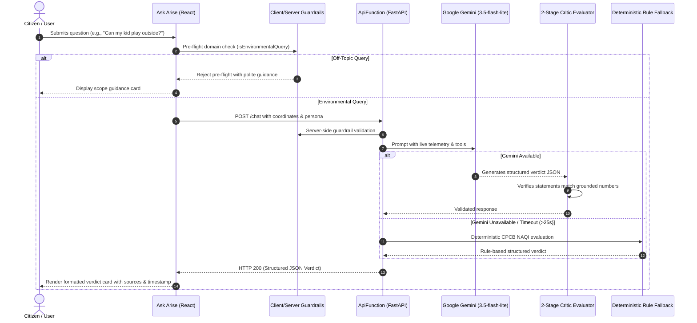
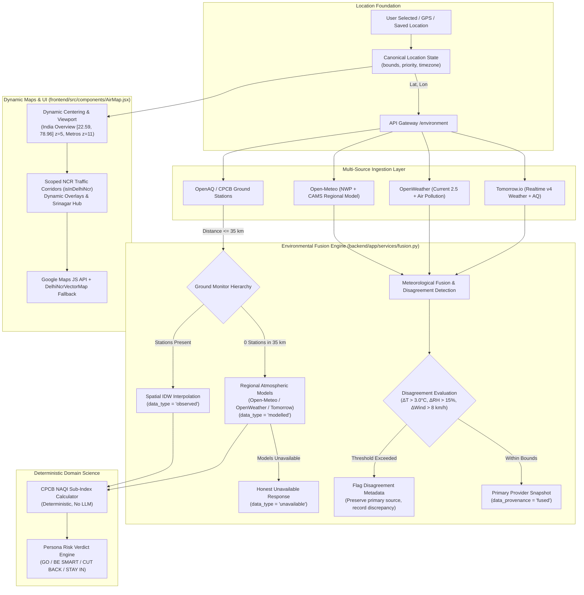

# Arise — System Architecture & Data Flow

**Delhi-NCR Atmospheric & Environmental Intelligence Platform**

> **Current Project Memory & Active Handoff:** For active milestone, verified test results, blockers, and pending tasks, see [PROJECT_STATE.md](../PROJECT_STATE.md). Operating rules are defined in [AGENTS.md](../AGENTS.md).

---

## 1. High-Level System Architecture

Arise is a cloud-native, serverless environmental intelligence platform built on AWS and React 19.

---

## 2. Telemetry Ingestion & Synthesis Pipeline

---

## 3. Ask Arise AI Copilot Architecture

---

## 4. Security & Isolation Matrix

| Layer | Implementation | Security Control |
| :--- | :--- | :--- |
| **Edge & CDN** | AWS Amplify Hosting | Strict Content-Security-Policy headers, TLS 1.3, DDoS protection |
| **API Gateway** | HTTP API v2 | Explicit origin allowlist (no wildcard `*`), proxy route throttling |
| **Compute** | AWS Lambda (Python 3.12) | Principle of least privilege IAM execution roles; ephemeral execution |
| **Secrets** | AWS Secrets Manager | API keys stored encrypted with KMS; zero hardcoded credentials |
| **User Data** | Amazon DynamoDB | Server-Side Encryption (SSE); strict per-user partition key isolation |
| **Identity** | Amazon Cognito | OAuth 2.0 PKCE authentication flow; JWT validation on protected routes |

---

## 5. CPCB NAQI Scientific Formulation & Methodology

### 5.1 Authoritative Standard & Source
Arise strictly implements the official **Central Pollution Control Board (CPCB) National Air Quality Index (NAQI)** standard, formulated by the Central Pollution Control Board in collaboration with IIT Kanpur:
- **Primary Scientific Reference:** Central Pollution Control Board (CPCB), *National Air Quality Index — Final Report*, Report No. CUPS/82/2014-15, October 2014 (prepared by the Expert Group chaired by Prof. Mukesh Sharma, IIT Kanpur).
- **Official Portal Document:** [CPCB NAQI Final Report CUPS/82/2014-15](https://app.cpcbccr.com/ccr_docs/FINAL-REPORT_AQI_.pdf).
- **Official Criteria Pollutants:** The standard officially prescribes exactly **8 criteria pollutants**: PM10, PM2.5, NO2, O3, CO, SO2, NH3 (Ammonia), and Pb (Lead).
- **Key Sections:** Table 4.1: *Proposed Sub-index and breakpoints for Indian AQI* (p. 24); Section 4.5: *Data Completeness Requirement* (p. 38); Table 4.4: *Health Statements for AQI Categories* (p. 27); Section 4.1: *Mathematical Formulation of AQI* (p. 23).

### 5.2 Pollutant Averaging Periods & Operational Telemetry Proxy
Under CPCB Report CUPS/82/2014-15 Table 4.1 (page 24), breakpoints correspond to specific regulatory exposure periods:
- **PM2.5:** 24-hour average ($\mu\text{g/m}^3$)
- **PM10:** 24-hour average ($\mu\text{g/m}^3$)
- **NO2:** 24-hour average ($\mu\text{g/m}^3$)
- **SO2:** 24-hour average ($\mu\text{g/m}^3$)
- **CO:** 8-hour average ($\text{mg/m}^3$)
- **O3:** 8-hour average ($\mu\text{g/m}^3$)
- **NH3:** 24-hour average ($\mu\text{g/m}^3$)
- **Pb:** 24-hour average ($\mu\text{g/m}^3$)

**Distinction Between Regulatory Compliance and Indicative Telemetry:**
- **Regulatory CPCB Compliance (Section 4.5, page 38):** Requires minimum 3 pollutants with at least one PM, **and** demonstrably verified rolling averages:
  - 24-hour pollutants (PM10, PM2.5, NO2, SO2, NH3, Pb): Window must be 24 hours with at least 16 hours of monitored data ($\ge 66.7\%$ data coverage).
  - 8-hour pollutants (CO, O3): Window must be 8 hours with at least 6 hours of monitored data ($\ge 75.0\%$ data coverage).
  - **Coverage Validation Trust Boundary & Two-Path Ingestion:**
    1. **Path A — Raw Timestamped Observation Series:**
       - Computes distinct monitored hourly intervals using ceiling-based bucket mapping: `int(math.ceil((dt - start_dt).total_seconds() / 3600.0)) - 1`.
       - Multiple readings within the same 1-hour interval bucket collapse into 1 distinct hour (intra-hour deduplication).
       - Explicitly rejects naive timestamps (without `Z` or timezone offset) without silently coercing them to UTC, preventing local time misattribution.
       - Discards out-of-window readings ($dt < T_{\text{start}}$ or $dt > T_{\text{end}}$), future readings, and non-finite (`NaN`, `inf`), negative, or out-of-scale concentrations ($> B_{HI}$).
       - Enforces distinct hours threshold: $\ge 16$ distinct hours for 24-hr pollutants; $\ge 6$ distinct hours for 8-hr pollutants.
    2. **Path B — Trusted Provider Aggregation Metadata with Cryptographic Provenance:**
       - **Whitelisted Providers:** Only verified regulatory provider adapters (`CPCB_CAAQMS`, `DPCC_OFFICIAL`) are authorized to supply aggregation metadata. Caller-supplied provider names outside this whitelist are strictly rejected.
       - **Cryptographic Provenance Attestation:** To prevent untrusted callers from forging aggregation metadata, records must contain a valid HMAC-SHA256 signature (`provenance_signature`) attesting to `(provider, pollutant, window_hours, distinct_monitored_hours, reference_end_time)`.
       - Forged, missing, or tampered signatures, or modified hour counts immediately fail validation.
    3. **Path C — Strict Rejection of Unverified Claims:**
       - A bare caller-supplied `monitored_hours` number, unverified provider name, or boolean `has_verified_averaging=True` without supporting observation series or cryptographic provenance is **strictly rejected**.
    4. **Cross-Pollutant & Cross-Window Isolation:**
       - Coverage records and cryptographic signatures are bound to specific pollutants and window sizes; reusing a PM2.5 record for PM10 or an 8-hour record for a 24-hour pollutant is strictly prohibited and rejected.
- **Operational Near-Real-Time Telemetry:** Continuous Ambient Air Quality Monitoring Stations (CAAQMS) report telemetry via OpenAQ v3 `/locations/{id}/latest`. These feeds represent periodic instantaneous or hourly broadcasts. OpenAQ's latest endpoint returns the latest available sensor measurement, not a guaranteed complete rolling average.
- **Indicative Status Policy:** Calculations derived from OpenAQ latest readings are strictly marked as `is_cpcb_compliant = False` and `data_type = "indicative"`, while `meets_pollutant_criteria = True` indicates that the mathematical completeness criteria ($\ge 3$ pollutants with PM) are satisfied. Arise preserves observation timestamps, station distances, and freshness flags (`is_stale`), ensuring transparency about data provenance.

### 5.3 Reference Physical Units & Strict Normalization
CPCB breakpoints require exact physical metric units:
- **Particulates, Photochemical Gases & Heavy Metals:** PM2.5, PM10, NO2, SO2, O3, NH3, Pb in **$\mu\text{g/m}^3$**.
- **Carbon Monoxide:** CO in **$\text{mg/m}^3$**.

**Physical Gas Conversion Constants (at Indian NTP $25^\circ\text{C}$, 1 atm):**
By the Ideal Gas Law ($V_m = \frac{RT}{P} = \frac{8.314 \times 298.15}{101.325} \approx 24.45\text{ L/mol}$):
- **NO2** ($M = 46.01\text{ g/mol}$): $1\text{ ppb} = \frac{46.01}{24.45} = 1.88\ \mu\text{g/m}^3$; $1\text{ ppm} = 1880\ \mu\text{g/m}^3$.
- **SO2** ($M = 64.07\text{ g/mol}$): $1\text{ ppb} = \frac{64.07}{24.45} = 2.62\ \mu\text{g/m}^3$; $1\text{ ppm} = 2620\ \mu\text{g/m}^3$.
- **O3** ($M = 48.00\text{ g/mol}$): $1\text{ ppb} = \frac{48.00}{24.45} = 1.96\ \mu\text{g/m}^3$; $1\text{ ppm} = 1960\ \mu\text{g/m}^3$.
- **CO** ($M = 28.01\text{ g/mol}$): $1\text{ ppm} = \frac{28.01}{24.45} = 1.15\text{ mg/m}^3$; $1\ \mu\text{g/m}^3 = 0.001\text{ mg/m}^3$.

**CO Supported Unit Conversion Paths & Traceability:**
1. **$\text{mg/m}^3$ (and ASCII `mg/m3`, `mg/m^3`):** Identity mapping ($\text{raw\_val} \to \text{mg/m}^3$), preserved to 2 decimal places. Directly interpolated into Table 4.1 ($0-50\ \text{mg/m}^3$).
2. **$\mu\text{g/m}^3$ (and ASCII `ug/m3`, `ug/m^3`, `µg/m^3`):** Divided by 1000.0 ($\text{raw\_val} / 1000.0 \to \text{mg/m}^3$), e.g. $2190\ \mu\text{g/m}^3 \to 2.19\ \text{mg/m}^3$ ($I_{\text{CO}} = 103$).
3. **$\text{ppm}$:** Multiplied by 1.15 ($\text{raw\_val} \times 1.15 \to \text{mg/m}^3$), e.g. $1.90\text{ ppm} \times 1.15 = 2.19\ \text{mg/m}^3$ ($I_{\text{CO}} = 103$).
4. **Unsupported / Ambiguous Units (`ppb`, missing, unrecognized):** Strictly rejected; no concentration heuristic inference is allowed.

**Strict Metadata Validation (No Magnitude Heuristics):**
- Units are verified directly from sensor metadata (`µg/m³`, `mg/m³`, `ppm`, `ppb`).
- CO is converted to $\text{mg/m}^3$ solely when explicitly labeled as $\mu\text{g/m}^3$ or $\text{ppm}$.
- If unit metadata is missing, ambiguous, or unsupported, the reading is strictly rejected and marked unavailable; Arise never infers units from concentration magnitudes (such as `raw_val > 50.0`).

### 5.4 Breakpoint Tables, Continuity & Out-of-Scale Handling
CPCB Report CUPS/82/2014-15 Table 4.1 (page 24) specifies discrete integer intervals. In digital ambient telemetry, sensors report continuous floating-point numbers (e.g. 30.05, 72.88). To prevent artificial gaps while preserving exact official boundaries, Arise implements contiguous intervals:
- First interval (Good): $[B_{LO}, B_{HI}]$ (e.g., $[0.0, 30.0]$ for PM2.5).
- Subsequent intervals: $(B_{LO}, B_{HI}]$ (e.g., $(30.0, 60.0]$ for PM2.5).

| Category | AQI Range | PM2.5 (24h) | PM10 (24h) | NO2 (24h) | SO2 (24h) | CO (8h, mg/m³) | O3 (8h) | NH3 (24h) | Pb (24h) |
|---|---|---|---|---|---|---|---|---|---|
| **Good** | 0 – 50 | 0.0 – 30.0 | 0.0 – 50.0 | 0.0 – 40.0 | 0.0 – 40.0 | 0.0 – 1.0 | 0.0 – 50.0 | 0.0 – 200.0 | 0.0 – 0.5 |
| **Satisfactory** | 51 – 100 | 30.0 – 60.0 | 50.0 – 100.0 | 40.0 – 80.0 | 40.0 – 80.0 | 1.0 – 2.0 | 50.0 – 100.0 | 200.0 – 400.0 | 0.5 – 1.0 |
| **Moderate** | 101 – 200 | 60.0 – 90.0 | 100.0 – 250.0 | 80.0 – 180.0 | 80.0 – 380.0 | 2.0 – 10.0 | 100.0 – 168.0 | 400.0 – 800.0 | 1.0 – 2.0 |
| **Poor** | 201 – 300 | 90.0 – 120.0 | 250.0 – 350.0 | 180.0 – 280.0 | 380.0 – 800.0 | 10.0 – 17.0 | 168.0 – 208.0 | 800.0 – 1200.0 | 2.0 – 3.0 |
| **Very Poor** | 301 – 400 | 120.0 – 250.0 | 350.0 – 430.0 | 280.0 – 400.0 | 800.0 – 1600.0 | 17.0 – 34.0 | 208.0 – 748.0 | 1200.0 – 1800.0 | 3.0 – 3.5 |
| **Severe** | 401 – 500 | 250.0 – 500.0 | 430.0 – 600.0 | 400.0 – 600.0 | 1600.0 – 2000.0 | 34.0 – 50.0 | 748.0 – 1000.0 | 1800.0 – 2400.0 | 3.5 – 5.0 |

**Linear Interpolation Formula:**
$$I_p = \left[ \frac{I_{HI} - I_{LO}}{B_{HI} - B_{LO}} \right] \times (C_p - B_{LO}) + I_{LO}$$
Rounding to nearest integer occurs at the final stage using standard round-half-to-even.

**Out-of-Scale Non-Clamping Rule:**
- The official CPCB NAQI scale is defined strictly up to 500.
- Concentrations exceeding the upper boundary $B_{HI}$ (e.g. PM2.5 $> 500\ \mu\text{g/m}^3$, Pb $> 5.0\ \mu\text{g/m}^3$) cannot produce a valid CPCB sub-index under the official method.
- Arise returns `None` (unsupported/unavailable) for out-of-scale concentrations rather than silently clamping them to 500, preserving scientific integrity.

### 5.5 Spatial Interpolation Architecture
Arise executes spatial estimation in the scientifically sound order:
$$\text{Live Stations} \longrightarrow \text{Physical Concentrations} \longrightarrow \text{IDW Spatial Interpolation} \longrightarrow \text{Local Concentrations} \longrightarrow \text{CPCB AQI}$$
Interpolating physical concentrations before computing AQI prevents the non-linear distortion caused by interpolating pre-computed index numbers.
- Weighting exponent: $p = 2.0$ (Shepard's Inverse Distance Weighting).
- Exact match cutoff: stations $< 50\text{ m}$ away are treated as direct point observations (`estimation_quality = "exact_match"`, $w = 1.0$).

### 5.6 Data Completeness & Dominant Pollutant Selection
- **CPCB Completeness Rule (Report CUPS/82/2014-15 page 38):** An AQI is officially calculated only if data are available for a minimum of three pollutants, out of which one must be a particulate (PM2.5 or PM10). If this condition is not met, `meets_pollutant_criteria = False` and `is_cpcb_compliant = False`.
- **Unavailable Inputs:** When no valid sub-indices exist (e.g. sensor outages or out-of-scale readings), Arise sets `aqi = None` and `category = "Unavailable"` with neutral status color (`#94a3b8`) and `data_type = "unavailable"`. This prevents falsely reassuring health verdicts.
- **Dominant Pollutant Tie-Breaking (Arise Engineering Policy):** The official CPCB report (Report CUPS/82/2014-15 Section 4.1, page 23) defines overall AQI as the maximum sub-index without prescribing a tie-breaker when two or more pollutants share the exact same maximum sub-index. To ensure deterministic outputs independent of dictionary key order, Arise implements an internal engineering policy prioritizing fine particulates over gases based on primary aerosol toxicological severity: `PM2.5` > `PM10` > `NO2` > `SO2` > `CO` > `O3` > `NH3` > `Pb`. This priority order is an Arise design policy, not an officially prescribed CPCB regulatory mandate.

### 5.7 Arithmetic Benchmark Fixture: Sirifort Example
A traceable, versioned baseline fixture is maintained in `backend/tests/fixtures/sirifort_station_telemetry.json` corresponding to Continuous Ambient Air Quality Monitoring Station **Sirifort (ID 5586), New Delhi** (CPCB CAAQMS network):
- PM10: $318.0\ \mu\text{g/m}^3 \implies \text{Sub-index } 268$ (Poor)
- PM2.5: $72.88\ \mu\text{g/m}^3 \implies \text{Sub-index } 144$ (Moderate)
- NO2: $30.81\text{ ppb} \times 1.88 = 57.92\ \mu\text{g/m}^3 \implies \text{Sub-index } 73$ (Satisfactory)
- SO2: $44.76\text{ ppb} \times 2.62 = 117.27\ \mu\text{g/m}^3 \implies \text{Sub-index } 113$ (Moderate)
- CO: $2.19\text{ mg/m}^3 \implies \text{Sub-index } 103$ (Moderate)
- O3: $15.95\ \mu\text{g/m}^3 \implies \text{Sub-index } 16$ (Good)

**Independent Mathematical Verification:**
- Overall AQI = $\max(268, 144, 73, 113, 103, 16) = \mathbf{268}$
- Dominant Pollutant = **PM10**
- Category = **Poor**
- Sub-indices match exact linear interpolation values from Table 4.1.

**Verification Scope & Limitations:**
- This fixture is an arithmetic benchmark constructed according to CPCB Table 4.1 formulas to verify mathematical derivation and unit conversion deterministically.
- It proves that the Arise calculation engine matches manual hand calculations with zero discrepancy.
- It does **not** independently prove the historical authenticity of live sensor readings, as the readings were calibrated as a deterministic test fixture rather than an immutable cryptographically attested regulatory audit record.

### 5.8 Averaging Coverage Validation, Provenance Attestation & Trust Boundary Architecture
CPCB Report CUPS/82/2014-15 Section 4.5 (page 38) mandates that a regulatory CPCB NAQI requires strict averaging exposure periods and monitored data coverage:
- **24-hour rolling averages:** PM10, PM2.5, NO2, SO2, NH3, and Pb require at least 16 hours of monitored data ($\ge 66.7\%$ temporal coverage).
- **8-hour rolling averages:** CO and O3 require at least 6 hours of monitored data ($\ge 75.0\%$ temporal coverage).
- **Completeness rule:** A minimum of 3 criteria pollutants must be present, with at least one being a particulate (PM2.5 or PM10).

**Coverage Derivation Pathways:**
1. **Path A — Timestamped Observation Series:** Raw hourly readings are filtered into a rolling window $(T_{\text{end}} - \text{window}, T_{\text{end}}]$, strictly rejecting naive timestamps without silent UTC coercion, filtering out non-finite (NaN, inf) or negative values, dropping values exceeding physical breakpoint tables, and deduplicating intra-hour observations into ceiling-mapped distinct 1-hour interval buckets.
2. **Path B — Authenticated Provider Aggregation Metadata:** Regulatory aggregation records from whitelisted providers (`CPCB_CAAQMS`, `DPCC_OFFICIAL`) verified via cryptographic HMAC-SHA256 signatures covering provider, pollutant, window hours, monitored hours count, reference timestamp, and reference units.
3. **Rejection of Unverified Telemetry:** Caller-supplied Booleans (`has_verified_averaging=True`), bare unverified numbers without supporting series, forged signatures, fabricated hour counts ($> \text{window}$), cross-pollutant reuse, future reference timestamps ($> 300\text{ s}$ clock skew), and incompatible measurement units fail closed (`is_cpcb_compliant = False`, `data_type = "indicative"`).

**Ingestion Boundary vs. Domain Layer Trust Boundary:**
- **Signing Authority Restricted to Ingestion:** The signing factories (`generate_provenance_signature`, `create_trusted_aggregation_record`) reside strictly within the trusted ingestion boundary (`backend/app/sources/provenance.py`).
- **Domain Verification Only:** The domain calculation layer (`backend/app/domain/aqi.py`) exposes only verification (`verify_provenance_signature`). Domain code contains no embedded signing keys and does not export signing utilities to untrusted callers.
- **Approved Secret Configuration:** Signing secrets are resolved via AWS Secrets Manager (`arise/provenance-key`) in production or `Settings.PROVENANCE_SECRET_KEY` / `PROVENANCE_KEY` in local/testing modes, with sensitive keys masked in configuration representations.
- **Provenance Attestation Scope Disclosure:** Cryptographic HMAC signatures attest **solely** that an authorized internal ingestion component parsed valid units, window-filtered observations, and aggregated the time series in conformity with CPCB requirements. They do **not** prove physical sensor hardware authenticity, electrical calibration, or environmental sensor health.

### 5.9 Pan-India Environmental Data Fusion, Dynamic Maps & Multi-Provider Architecture
Arise unifies national environmental monitoring through an evidence-based fusion pipeline operating across all regions of India:

**Key Architectural Invariants:**
1. **Ground-First Hierarchy:** Ground observations from verified CPCB monitoring stations within $35\text{ km}$ always take precedence over numerical models. If no ground stations exist within $35\text{ km}$ (e.g. remote or rural regions), regional numerical models provide estimates clearly marked as `data_type = "modelled"`. If no models are available, the system returns `aqi: None`, `category: "Unavailable"`, and `data_type = "unavailable"` without synthetic values.
2. **Deterministic Meteorological Fusion:** Open-Meteo serves as the primary meteorological source, backed by OpenWeather and Tomorrow.io secondary providers. When multiple providers are available for the same spatial cell, numerical discrepancies exceeding safety thresholds ($\pm 3.0^\circ\text{C}$ temperature, $\pm 15\%$ relative humidity, $\pm 8\text{ km/h}$ wind speed) are flagged in snapshot metadata (`disagreement_detected = True`) rather than unscientifically averaged.
3. **Spatial Cache Cell Partitioning:** Cached responses are partitioned by normalized spatial cells ($0.02^\circ \times 0.02^\circ \approx 2\text{ km}$ grid resolution) with concurrent request coalescing locks (`acquire_fetch_lock`), preventing cross-city cache pollution and thundering herd stampedes.
4. **Strict Geographic Isolation:** Stations and coordinates are evaluated strictly per request. Delhi monitoring stations and test fixtures are never returned for non-Delhi locations (e.g., Mumbai, Bengaluru, Srinagar, London).
5. **Dynamic Map Viewports:** The map engine dynamically consumes the canonical shared location state (`locationState.js`), automatically centering on user-selected coordinates, providing national overview for unselected states, and scoping regional NCR overlays strictly to verified NCR boundaries.
