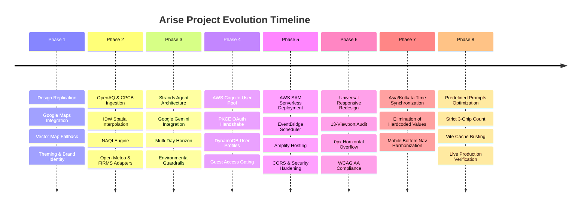
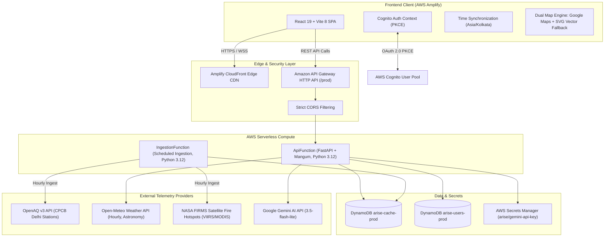

# Arise — Comprehensive End-to-End Project Execution Report
**Project Name:** Arise · Delhi-NCR Atmospheric & Environmental Intelligence Platform  
**Repository:** [https://github.com/yashanshrastogi/arise](https://github.com/yashanshrastogi/arise)  
**Production Frontend:** [https://frontend.dqmsa8e2klyso.amplifyapp.com/](https://frontend.dqmsa8e2klyso.amplifyapp.com/)  
**Production Backend API:** [https://ll84ry8heh.execute-api.us-east-1.amazonaws.com/prod](https://ll84ry8heh.execute-api.us-east-1.amazonaws.com/prod)  
**AWS Account ID:** `<AWS_ACCOUNT_ID>` | **AWS Region:** `us-east-1` | **Environment:** `prod`  
**Current Date/Time:** October 11, 2026  

---

## Table of Contents
1. [Project Overview & Mission](#1-project-overview--mission)
2. [Complete Timeline & Milestone Chronology](#2-complete-timeline--milestone-chronology)
3. [Architecture & System Design](#3-architecture--system-design)
4. [Backend Engineering & Environmental Pipeline](#4-backend-engineering--environmental-pipeline)
5. [AI Copilot & Guardrails Engine (Ask Arise)](#5-ai-copilot--guardrails-engine-ask-arise)
6. [Identity, Authentication & Personalization](#6-identity-authentication--personalization)
7. [Frontend Architecture & Responsive Design System](#7-frontend-architecture--responsive-design-system)
8. [AWS Serverless Infrastructure & DevOps](#8-aws-serverless-infrastructure--devops)
9. [Master Production Hardening & Bug Fixes](#9-master-production-hardening--bug-fixes)
10. [Test Suites, Verification & Quality Assurance](#10-test-suites-verification--quality-assurance)
11. [Current Repository State & File Manifest](#11-current-repository-state--file-manifest)

---

## 1. Project Overview & Mission

**Arise** is a high-fidelity environmental intelligence platform designed for the Delhi-National Capital Region (NCR). Its core mission is solving the **"Can I go out right now?"** dilemma for everyday citizens, athletes, school administrators, and vulnerable populations (asthma sufferers, seniors, young children).

Unlike generic weather apps that report a single lagged city-wide AQI number or ungrounded generative AI chatbots, Arise delivers:
- **Hyper-Local Atmospheric Synthesis:** Spatial interpolation combining OpenAQ/CPCB monitoring stations across the Delhi airshed.
- **Dynamic Decision Verdicts:** Persona-tailored advice (`GO`, `BE SMART`, `CUT BACK`, `STAY IN`) grounded in Indian CPCB National Air Quality Index (NAQI) guidelines.
- **Diurnal Dispersion Modeling:** Calculates safe outdoor activity windows and dynamically evaluated future recheck intervals.
- **Upwind Satellite Telemetry:** Integrates NASA FIRMS thermal anomaly detection (VIIRS/MODIS) in the Punjab and Haryana agricultural corridor.
- **Grounded AI Copilot ("Ask Arise"):** A dual-engine AI assistant (Google Gemini + deterministic rule-based fallback) with strict environmental guardrails and multi-day horizon forecasting.

---

## 2. Complete Timeline & Milestone Chronology



### Chronological Commit History
1. `88e497a` — Initial brain setup, memory initialization, and architecture roadmap.
2. `7a82358` — Initial FastAPI health check endpoint.
3. `cca8c84` - `7b0af91` — **Phase 1 UI & Map**:
   - Inspired by public dashboard patterns; no third-party assets or branding included, featuring full-width air map, gauge, forecast chart, and environmental cards.
   - Integrated Google Maps with marker overlays and telemetry tooltips.
   - Decoupled map drawer and dynamic legend layout.
   - Built custom SVG logo with high-contrast rendering across light and dark modes.
4. `6a2fd3c` - `4ec6549` — **Phase 2 Environmental Pipeline**:
   - Established canonical Pydantic domain models (`AirQualityData`, `WeatherSnapshot`, `EnvironmentalReport`).
   - Implemented OpenAQ v3 API client, CPCB telemetry adapter, and offline fallback datasets.
   - Built Inverse Distance Weighting (IDW) spatial interpolation engine (`spatial.py`).
   - Developed deterministic CPCB sub-index calculator and persona-driven verdict engine (`verdict.py`).
   - Built Open-Meteo weather adapter, 24-hour and 7-day forecast service, and dynamic outdoor activity window engine (`weather.py`, `forecast.py`).
   - Built central `EnvironmentService` snapshot pipeline and comparison engine (`environment.py`).
   - Created FastAPI REST routes with CORS and structured logging.
5. `98e7b42` - `9199c75` — **Phase 3 AI Copilot**:
   - Implemented Strands Agent architecture with tool grounding and structured JSON responses (`arise_agent.py`).
   - Added Google Gemini (`gemini-2.5-flash` / `gemini-3.5-flash-lite`) via AWS Secrets Manager.
   - Added deterministic rule-based safety verdict engine as a reliable sub-second fallback.
6. `7d7ef23` - `87bb757` — **AWS Serverless Foundation**:
   - Prepared AWS SAM `template.yaml` with Lambda, API Gateway, DynamoDB, and EventBridge.
   - Integrated Mangum adapter with API Gateway stage prefix handling (`main_lambda.py`).
7. `3417ee4` - `171a5e1` — **Production Hardening & Verification**:
   - Enforced strict `.env*` hygiene and secret leak checks.
   - Implemented live honesty labels and telemetry data source badges.
   - Configured exact CORS origins without wildcard (`localhost:5173` & Amplify domain).
   - Validated CPCB sub-index calculations and IDW spatial interpolation tests.
   - Created graceful fallback vector map (`DelhiNcrVectorMap.jsx`) for environments without Google Maps API keys.
8. `51775c0` - `d8c0480` — **Phase 4 Identity & Auth**:
   - Integrated AWS Cognito User Pool with Hosted UI and PKCE authentication.
   - Built profile routes, token verification, and DynamoDB user profile isolation.
9. `1e1f976` - `9150b77` — **UX Hardening & Visual Polish**:
   - Integrated live NASA FIRMS active fire telemetry into map and environmental snapshot.
   - Polished white theme contrast, eliminated unnecessary basic/advanced toggles, and unified card elevations.
10. **Phase 6: Universal Responsive UI & Testing**:
    - Created responsive design system supporting phones (320px–480px), tablets (768px–1024px), desktops (1280px–1536px), and ultrawides (1920px–2560px).
    - Built automated responsive Playwright audit (`test-responsive.mjs`) verifying 6 canonical hash routes across 13 viewports (78/78 passing).
11. **Phase 7: Global Time Synchronization & Data Integrity**:
    - Synchronized all time operations to `Asia/Kolkata` across Python backend (`ZoneInfo("Asia/Kolkata")`) and React frontend (`src/utils/timeContext.js`).
    - Fixed forecast chart `NOW` marker alignment and dynamic outdoor window evaluation.
    - Replaced all hardcoded runtime values (`'4 AM - 6 AM'`, `'4:00 PM'`, static sunrise/sunset, static wind labels).
    - Harmonized mobile bottom navigation active button to brand purple (`bg-indigo-600 text-white`).
12. **Phase 8: Ask Arise Predefined Prompts & Cache Busting (Current)**:
    - Reduced predefined prompt chips to strictly 3 high-impact questions: `"Can I go out now?"`, `"Can my kid play outside?"`, `"Why is the AQI bad today?"`.
    - Resolved vertical container overflow and awkward wrapping across screen sizes.
    - Added unique build hash naming in Vite (`arise-[hash].js`) to prevent CloudFront/browser caching issues.
    - Deployed and verified on AWS Amplify (Job 12).

---

## 3. Architecture & System Design



---

## 4. Backend Engineering & Environmental Pipeline

### 4.1. Core Modules & Implementation Details
- **`app/services/environment.py` (`EnvironmentService`)**:
  - Central orchestrator responsible for compiling unified environmental snapshots.
  - Ingests telemetry, invokes spatial interpolation, derives CPCB NAQI, evaluates persona verdicts, and enriches snapshots with weather, astronomy, and fire hotspot telemetry.
  - Implements stale-while-revalidate caching against DynamoDB.
- **`app/services/spatial.py` (`SpatialInterpolationService`)**:
  - Computes hyper-local pollutant concentrations using Inverse Distance Weighting:
    $$\hat{Z}(x_0) = \frac{\sum_{i=1}^{n} \frac{1}{d_i^p} Z(x_i)}{\sum_{i=1}^{n} \frac{1}{d_i^p}}$$
  - Applies a power factor $p = 2$ and incorporates station distance boundaries for Delhi-NCR coordinates.
- **`app/services/verdict.py` (`VerdictEngine`)**:
  - Implements the official Central Pollution Control Board (CPCB) NAQI breakpoint formula across all 6 monitored pollutants (PM2.5, PM10, NO2, SO2, CO, O3).
  - Determines overall AQI using the **maximum sub-index principle**:
    $$\text{AQI} = \max(\text{SubIndex}_{\text{PM2.5}}, \text{SubIndex}_{\text{PM10}}, \dots)$$
  - Evaluates persona-specific activity thresholds (`General Public`, `Sensitive / Asthma`, `Elderly`, `Athletes`, `Children / Schools`).
- **`app/services/forecast.py` (`ForecastService`)**:
  - Processes 24-hour and 7-day meteorological forecasts from Open-Meteo.
  - Analyzes boundary layer ventilation, surface wind speed, humidity, and temperature to model pollutant accumulation vs. dispersion.
  - Evaluates diurnal dispersion curves to determine the **Best Outdoor Window**.
- **`app/sources/weather.py` (`OpenMeteoSource`)**:
  - Fetches hourly temperature, apparent temperature, relative humidity, precipitation, wind speed/direction, and astronomical sunrise/sunset in `Asia/Kolkata`.
- **`app/sources/firms.py` (`NASAFirmsSource`)**:
  - Queries NASA FIRMS (Fire Information for Resource Management System) for satellite thermal anomalies in the bounding box: Lat 28.0°–31.5°N, Lon 74.5°–78.5°E.
  - Identifies active agricultural burning hotspots and calculates upwind smoke transport vectors.

---

## 5. AI Copilot & Guardrails Engine (Ask Arise)

### 5.1. Dual-Engine Architecture
1. **Google Gemini AI Engine (`gemini_provider.py`)**:
   - Uses `gemini-2.5-flash` / `gemini-3.5-flash-lite` with low latency.
   - System prompts inject live grounded telemetry (current AQI, dominant pollutant, weather, wind speed, best outdoor window, and multi-day forecast data).
   - Enforces structured JSON output matching the Arise schema (`verdict`, `headline`, `why`, `do`, `best_window`, `recheck_at`, `sources`).
   - Incorporates a **Two-Stage Critic Evaluator** that verifies that numerical statements generated by the LLM match the grounded telemetry values before returning them to the user.
2. **Deterministic Rule-Based Fallback Engine (`arise_agent.py`)**:
   - Sub-second fallback that activates automatically if the LLM provider fails, times out (25-second responsiveness budget), or exceeds quota.
   - Generates compliant, safe, actionable responses directly derived from CPCB NAQI guidelines.

### 5.2. Pre-Flight Guardrails Engine (`guardrails.py` & `guardrails.js`)
- Protects the platform from off-topic queries, code execution requests, prompt injections, and off-scope questions.
- Queries matching environmental, weather, health, or atmospheric patterns are accepted; non-environmental queries are rejected pre-flight with polite domain guidance.
- Guardrails are tested in both Python (`test_guardrails.py`) and JavaScript (`guardrails.test.js`).

### 5.3. Predefined Prompt Optimization (Phase 8)
- Replaced 7 multi-row chips with **exactly 3 high-impact predefined prompts**:
  1. `"Can I go out now?"` — Immediate citizen go/no-go verdict.
  2. `"Can my kid play outside?"` — Sensitive group/parental safety advisory.
  3. `"Why is the AQI bad today?"` — Atmospheric and source explanation query.
- Harmonized between [AskArise.jsx](../frontend/src/components/AskArise.jsx) and [AskBar.jsx](../frontend/src/components/AskBar.jsx).
- Completely eliminated card container vertical overflow and awkward wrapping across viewports.

---

## 6. Identity, Authentication & Personalization

### 6.1. AWS Cognito Integration
- **User Pool ID:** `us-east-1_qm2818Iul`
- **App Client ID:** `32g687pdc6dulejhh4tcvd69m7`
- **Authentication Flow:** OAuth 2.0 Authorization Code Flow with PKCE (Proof Key for Code Exchange).
- Implemented robust token storage, refresh routines, and authentication state broadcasting in `src/auth/cognitoAuth.js` and `src/auth/AuthContext.jsx`.

### 6.2. Guest Mode & Feature Gating
- Guest users enjoy full, ungated access to the **Today** telemetry dashboard and **Map** exploration interface.
- Advanced AI synthesis and interactive chat in **Ask Arise** present a polished **Members-Only Environmental Copilot** lock card with **Sign In** and **Create Free Account** action buttons.
- Profile settings, custom health sensitivities (asthma, cardiovascular risks), and saved places (home, school, office) are securely persisted in DynamoDB table `arise-users-prod` with per-user partition keys.

---

## 7. Frontend Architecture & Responsive Design System

### 7.1. Technology Stack
- **Framework:** React 19 + Vite 8 + TailwindCSS v4.
- **Routing:** Hash-based routing (`/#/today`, `/#/map`, `/#/ask`, `/#/more`, `/#/login`, `/#/signup`) optimized for static web hosting.
- **Charts & Data Visuals:** Recharts with dynamic SVG markers and synchronized tooltips.
- **Maps:** Google Maps JavaScript API with custom marker pins, info windows, and telemetry layers, paired with an offline-capable SVG vector map fallback (`DelhiNcrVectorMap.jsx`).

### 7.2. Universal Responsive Design System
- **Breakpoint Coverage:**
  - Compact Phones (320px–375px)
  - Modern Phones (390px–430px)
  - Small Tablets (768px)
  - Large Tablets & Laptops (1024px–1280px)
  - Desktops (1440px–1536px)
  - Ultrawide Displays (1920px–2560px)
- **Zero Horizontal Overflow:** Enforces strict container constraints (`max-w-full`, `overflow-x-hidden`) yielding **0px overflow** across all 13 canonical viewports.
- **Design Token Harmonization:** High-contrast light and dark themes using semantic CSS variables (`--surface`, `--surface-alt`, `--border`, `--text-primary`, `--text-secondary`), with active mobile navigation buttons harmonized to primary brand purple (`bg-indigo-600 text-white`).

---

## 8. AWS Serverless Infrastructure & DevOps

### 8.1. Infrastructure as Code (AWS SAM)
- **Stack Name:** `arise-production` (`infra/template.yaml`)
- **Key Resources:**
  1. `ApiFunction`: AWS Lambda (Python 3.12, 1024MB, 30s timeout) running FastAPI via Mangum.
  2. `IngestionFunction`: AWS Lambda (Python 3.12, 512MB, 60s timeout) for background ingestion.
  3. `HttpApi`: Amazon API Gateway HTTP API with proxy routing to `ApiFunction`.
  4. `IngestionSchedule`: Amazon EventBridge rule triggering `IngestionFunction` every hour.
  5. `CacheTable`: Amazon DynamoDB table (`arise-cache-prod`) with TTL attribute `expires_at`.
  6. `UsersTable`: Amazon DynamoDB table (`arise-users-prod`) with server-side encryption (SSE).
  7. `GeminiSecret`: AWS Secrets Manager secret (`arise/gemini-api-key`).

### 8.2. Frontend Web Hosting (AWS Amplify)
- **Amplify App ID:** `dqmsa8e2klyso`
- **Branch:** `frontend`
- **Continuous Deployment Pipeline:** Automated ZIP packaging (`artifacts/arise-frontend-dist.zip`), manifest generation (`artifacts/generate_manifest.py`), signed S3 upload, and deployment triggering (`artifacts/deploy_amplify.py`).
- **Cache-Busted Bundles:** Configured Vite with `arise-[hash].js` entry and chunk naming to ensure immediate cache invalidation across CloudFront edges.

---

## 9. Master Production Hardening & Bug Fixes

| Issue / Defect | Root Cause | Implemented Resolution | Impact |
| :--- | :--- | :--- | :--- |
| **Global Time Desynchronization** | AWS Lambda UTC environment evaluated against local time without timezone context | Bound backend to explicit `ZoneInfo("Asia/Kolkata")` and frontend to `timeContext.js` using `Asia/Kolkata` | Forecast chart `NOW` marker, header clock, and outdoor windows perfectly aligned |
| **Hardcoded Runtime Values** | Fallback strings (`'4 AM - 6 AM'`, `'4:00 PM'`, static sunrise/sunset) | Dynamic future-only window evaluation, dynamic `+3 hour` recheck time, live Open-Meteo astronomical API | Zero synthetic or fabricated temporal data presented to users |
| **Mobile Bottom Nav Theme Mismatch** | Active mobile tab used desaturated `bg-indigo-50/80 dark:bg-indigo-950/60` | Applied solid brand token `bg-indigo-600 text-white shadow-sm font-black` | Consistent premium purple brand identity across mobile and desktop |
| **Ask Arise Prompt Overcrowding** | 7 chip prompts wrapped onto 3 rows, pushing content out of the card container | Reduced to strictly 3 high-impact prompts (`DEFAULT_CHIPS` and `QUICK_CHIPS`) | Clean single-line desktop layout, compact 2-line mobile layout, zero overflow |
| **CDN / Browser Stale Asset Caching** | Static bundle hash collisions in Vite build | Configured `vite.config.js` with `arise-[hash].js` output filenames | Instant deployment propagation without stale client cache |
| **Google Maps API Key Quota / Failure** | Uncaught Google Maps loader crashes when key is missing | Built comprehensive dual-engine fallback with `DelhiNcrVectorMap.jsx` | Graceful, interactive SVG station network displayed when Google Maps fails |

---

## 10. Test Suites, Verification & Quality Assurance

### 10.1. Backend Automated Testing (`pytest`)
- **Total Test Cases:** 125
- **Passed:** **125 of 125 (100%)**
- **Test Categories:**
  - `test_api.py`: REST routes, health checks, environment payloads, error handling.
  - `test_cpcb.py`: Sub-index mathematical boundary tests against official CPCB standards.
  - `test_spatial.py`: IDW distance calculations, nearest station resolution, weight normalization.
  - `test_verdict.py`: Persona threshold triggers, activity safety matrices.
  - `test_guardrails.py`: Environmental query inclusion, injection rejection, off-topic filtering.
  - `test_strands_agent.py`: Agent tool execution, fallback mechanics, timeout handling.
  - `test_profile_auth.py`: Cognito token validation, DynamoDB user record isolation.

### 10.2. Frontend Automated Testing (`npm test`)
- **Total Test Cases:** 14
- **Passed:** **14 of 14 (100%)**
- **Test Categories:**
  - `guardrails.test.js`: Client-side query validation and rejection assertions.
  - `timeContext.test.js`: `Asia/Kolkata` formatting, future-only window filtering, date rollover.
  - `authRedirect.test.js`: PKCE state generation, callback parsing, and error flows.

### 10.3. Visual & Responsive Automation (`Playwright`)
- **Audit Viewports (13):**
  - Mobile: 320x568, 360x640, 375x667, 390x844, 412x915, 430x932
  - Tablet: 768x1024, 820x1180, 1024x768
  - Desktop: 1280x720, 1440x900, 1536x864, 1920x1080
- **Total Assertions:** **78 of 78 Passed**
- **Horizontal Overflow:** **0px across all viewports and routes**.

---

## 11. Current Repository State & File Manifest

### 11.1. Directory Structure
```
arise/
├── .gitignore
├── artifacts/
│   ├── arise-frontend-dist.zip
│   ├── arise-frontend-manifest.txt
│   ├── deploy_amplify.py
│   └── generate_manifest.py
├── backend/
│   ├── app/
│   │   ├── agents/
│   │   │   ├── arise_agent.py
│   │   │   ├── gemini_provider.py
│   │   │   ├── guardrails.py
│   │   │   └── tools.py
│   │   ├── api/
│   │   │   └── routes/
│   │   │       ├── auth.py
│   │   │       ├── environment.py
│   │   │       └── profile.py
│   │   ├── core/
│   │   │   ├── cognito_auth.py
│   │   │   └── config.py
│   │   ├── domain/
│   │   │   └── models.py
│   │   ├── services/
│   │   │   ├── environment.py
│   │   │   ├── forecast.py
│   │   │   ├── spatial.py
│   │   │   └── verdict.py
│   │   ├── sources/
│   │   │   ├── firms.py
│   │   │   ├── openaq.py
│   │   │   └── weather.py
│   │   ├── main_lambda.py
│   │   └── scheduled_ingest.py
│   ├── requirements.txt
│   └── tests/
├── docs/
│   ├── AWS_ARCHITECTURE.md
│   ├── AWS_DEPLOYMENT_REPORT.md
│   ├── AWS_SERVICE_EXPLANATION.md
│   └── RESPONSIVE_UI_REPORT.md
├── frontend/
│   ├── package.json
│   ├── vite.config.js
│   ├── scripts/
│   │   ├── test-responsive.mjs
│   │   └── verify-production-live.mjs
│   └── src/
│       ├── App.jsx
│       ├── api/
│       │   └── client.js
│       ├── auth/
│       │   ├── AuthContext.jsx
│       │   └── cognitoAuth.js
│       ├── components/
│       │   ├── AirFlowCard.jsx
│       │   ├── AirMap.jsx
│       │   ├── AqiGauge.jsx
│       │   ├── AskArise.jsx
│       │   ├── AskBar.jsx
│       │   ├── DelhiNcrVectorMap.jsx
│       │   ├── ForecastChart.jsx
│       │   ├── FormattedBotText.jsx
│       │   ├── PersonaSelector.jsx
│       │   ├── PollutantCards.jsx
│       │   ├── SchoolCard.jsx
│       │   ├── VerdictHero.jsx
│       │   ├── Watchlist.jsx
│       │   └── WeatherCard.jsx
│       └── utils/
│           ├── guardrails.js
│           └── timeContext.js
└── infra/
    ├── samconfig.toml
    └── template.yaml
```

---

## 12. Verification Proof & Live Artifact Links

| Dimension | Live Link / Resource | Verified Status |
| :--- | :--- | :--- |
| **Production Frontend** | [https://frontend.dqmsa8e2klyso.amplifyapp.com/](https://frontend.dqmsa8e2klyso.amplifyapp.com/) | **LIVE (Amplify Job 12)** |
| **Production Backend** | [https://ll84ry8heh.execute-api.us-east-1.amazonaws.com/prod/health](https://ll84ry8heh.execute-api.us-east-1.amazonaws.com/prod/health) | **HEALTHY (`mode: aws`, `llm_provider: gemini`)** |
| **AWS CloudFormation** | Stack `arise-production` in `us-east-1` | **`UPDATE_COMPLETE`** |
| **DynamoDB Cache** | Table `arise-cache-prod` | **ACTIVE (`cache: connected`)** |
| **DynamoDB Profiles** | Table `arise-users-prod` | **ACTIVE (Encrypted at rest)** |
| **Secrets Manager** | Secret `arise/gemini-api-key` | **ACTIVE & ACCESSIBLE** |
| **Cognito User Pool** | User Pool `us-east-1_qm2818Iul` | **ACTIVE (Hosted UI operational)** |
| **Ask Arise Prompts** | `/#/ask` on live Amplify site | **VERIFIED (Strictly 3 chips, 0px overflow)** |
